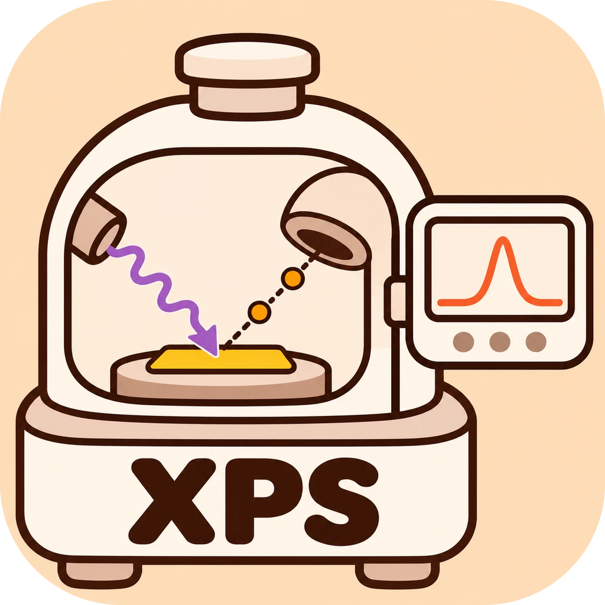

<p align="center"></p>

<h1 align="center">XPS Analyser</h1>
<p align="center">v1.2 · <a href="CHANGELOG.md">更新记录</a> · <a href="../../releases">全部版本</a></p>

XPS 峰拟合桌面程序，用来替代 XPSPEAK 4.1。读入 Thermo Avantage 的 `.VGD`（也支持导出的 Excel / CSV、XPSPEAK txt），一键拟合（按元素使用文献约束），自动判断检出限和拟合是否可靠，定量，并导出带标注的论文图。界面中文 / English 可切换。

*Desktop XPS peak-fitting app (a replacement for XPSPEAK 4.1): one-click fitting with literature constraints, detection limit and fit assessment, quantification, and publication figures with annotations. Chinese / English UI.*

## 下载

最新正式版本（Releases 里也保留各历史版本，如 v1.0）：

| 文件 | 说明 |
|---|---|
| [XPSAnalyser.exe](../../releases/latest/download/XPSAnalyser.exe) | Windows，双击运行，无需安装 Python |
| [XPSAnalyser-macOS-arm64.zip](../../releases/latest/download/XPSAnalyser-macOS-arm64.zip) | macOS（Apple 芯片 M1–M4）：解压得到 `XPS Analyser.app`，拖进“应用程序” |
| [Avantage2XPSPEAK.exe](../../releases/latest/download/Avantage2XPSPEAK.exe) | 小工具：把 Avantage `.VGD` / 导出表格转成 XPSPEAK 4.1 的两列 txt |

**macOS 首次打开**：程序没有苹果开发者签名，第一次请在“应用程序”里 **右键 → 打开 → 打开**；若提示“已损坏”，在终端运行一次 `xattr -cr "/Applications/XPS Analyser.app"`。

用户模板、灵敏度因子、导入的 NIST 数据保存在 `~/XPSAnalyser/`（Windows：`%USERPROFILE%\XPSAnalyser\`；以前用过旧版本的，继续使用原来的 `XPSFitStudio` 文件夹）。

## 主要功能

- **打开整个样品文件夹**：所有元素的谱按样品分组；文件名没有轨道信息时根据谱图识别轨道；全谱（survey）自动识别元素。
- **⚡ 一键拟合**：自动选背景（Shirley / Smart / 自定义点；Fe2p 用主动 Shirley），任何情况下背景不高于数据；按元素建模（Al2p、Co2p、Cr2p、Cu2p、Fe2p、O1s、C1s 等），每个候选化学态、残差里的每个峰都用 BIC 判断是否保留，并区分重叠峰 / 卫星峰 / 新化学态。
  - 自旋轨道双峰（2p1/2 与 2p3/2）的分裂、面积比、FWHM 倍率限制在文献范围内（金属与化合物分别给出）。
  - **碱金属 / 碱土金属的盐与深度剖析（v1.2）**：Ca、K、Mg 等按碳酸盐、氯化物等建模，金属态只在数据确有峰时才加；`.VGD` 深度剖析读出刻蚀时间，定量每层单独一行。
  - **没有内置模型的轨道按 NIST 数据库建模（v1.1）**：Ti2p、Zr3d、Nb3d、Ta4f、Hf4f、Mo3d、Mn2p、Ni2p、Si2p 等——NIST 中的单质 / 氧化物 / 氮化物 / 碳化物作为候选，自旋轨道双峰按文献范围，拟合后逐步剔除数据不需要的化学态。
  - **Fe2p 物相**：FeO / Fe₃O₄ / Fe₂O₃（及与金属 Fe 的组合），给出 Fe²⁺:Fe³⁺ 和范围。
  - **氧化态选择**：自动 / 金属+氧化 / 仅金属 / 仅氧化；选择与数据矛盾时会提醒。
  - 氧化态比例无法由谱唯一确定时（金属线形与氧化物难以区分），给出范围而不是一个数；同一样品各元素的氧化程度不符合热力学顺序时提醒。
  - **逐步放开约束**：一级一级放开（Lorentzian 比例、背景斜坡、FWHM 范围、金属拖尾、双峰关系超出文献范围、化合物不对称），每一步用 BIC 判断是否保留，可撤销。
- **检出限与拟合评估**：
  - 主线区间内 S/N < 4 判为**未检出**（不拟合峰，定量给出上限），4–10 为弱信号，≥ 10 可定量。
  - 每次拟合给出 **可靠 / 需检查 / 不可靠 / 未检出**，并列出依据（残差与噪声、约束边界、文献规则、未归属峰、比例是否唯一、不确定度……），同时给出该轨道在合成谱上的实测准确度。
- **参考数据库（v1.1）**：随程序发布 NIST XPS Database（SRD 20）中 23 种元素的 17,131 条记录（化学态结合能分布、双峰间距、俄歇参数），“推荐峰位”面板直接可用。
- **手动调整**：拖动峰顶改位置 / 高度 / 宽度；单峰、双峰、卫星峰、未知重叠峰；固定、上下限、参数相等；局部微调、多起点拟合；同组峰同色、可自选颜色。
- **定量**：元素原子 %、化学态原子 %、任意两项的比例，一键复制到 Excel。
- **堆叠对比**：多个样品的同一轨道上下错开对比（扣背景归一化 / 归一化 / 原始）。
- **导出**：先出预览，在预览上**加线、加文字、拉箭头**、改峰颜色，确认后导出 PNG / TIFF / SVG / PDF（字体 Arial，尺寸单位 pt，预览与导出 1:1）；堆叠图的样品名可上下拖动。另可导出 Excel（全部峰参数、曲线、评估）、CSV（给 Origin）、XPSPEAK txt、项目文件（可继续修改）。

## 文档

- [自动拟合操作规程（SOP）](docs/AUTOFIT_SOP.md)：操作流程、每一步算法、文献约束、检出限与评估的阈值、验证结果、参考文献。
- [合成谱验证结果](docs/benchmark_results.md)、[真实数据稳定性](docs/stability_real_data.md)、[更新记录](CHANGELOG.md)。

## 开发

```
pip install numpy scipy matplotlib pandas openpyxl xlrd pywebview
python run_xpsfit.py                 # 桌面窗口（没有 pywebview 时用浏览器打开）
python -m unittest test_xpsfit_core test_avantage_to_xpspeak
python tools/benchmark_autofit.py 8  # 已知真值的合成谱验证（XPS_BENCH_REALISTIC=1：峰位按 NIST 分布随机）
python tools/benchmark_nist.py 10    # 按 NIST 建模的轨道 vs 通用模型
python -m xpsfit.reference nist_xps_all_records.csv   # 由 NIST 导出文件重建随程序发布的参考库
```

推送到 `main` 后，GitHub Actions 在 Windows 与 macOS 上测试、打包，按 `xpsfit/__init__.py` 的版本号发布到 Releases（如 v1.1，历史版本保留），并更新滚动的 `latest` 构建。
